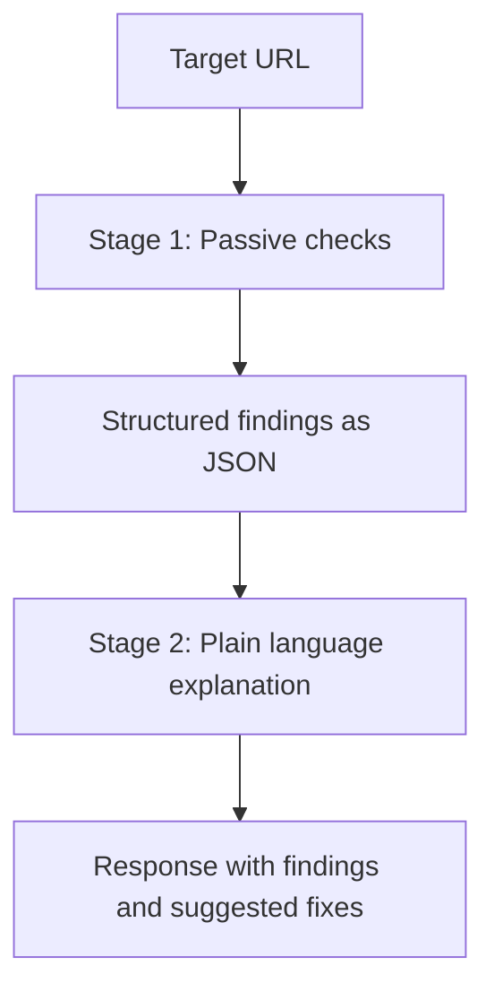
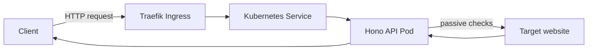

<div align="center">

# Website Check Tool

A website security and configuration checker built to learn Kubernetes end to end, from a Hono API to an Ingress-routed deployment.


</div>

## Table of Contents

- [About](#about)
- [Why Kubernetes](#why-kubernetes)
- [How It Works](#how-it-works)
- [Checks](#checks)
- [Technologies](#technologies)
- [Architecture](#architecture)
- [Getting Started](#getting-started)
- [Security Considerations](#security-considerations)
- [Roadmap](#roadmap)
- [License](#license)

## About

This tool scans a website for common security misconfigurations, missing protections, and accessibility issues, and reports them in plain language. It started as a learning project for Kubernetes and grew into something I actually wanted to exist: a quick way to check whether a site has basic security hygiene in place.

## Why Kubernetes

A project this size could run comfortably on Docker Compose. I chose Kubernetes anyway, deliberately, as the vehicle to learn Deployments, Services, Ingress, and the security primitives Kubernetes offers (Pod Security Standards, security contexts, resource limits) on a project that actually does something, rather than on throwaway exercises. The tradeoff is honest: more operational complexity than this app strictly needs, in exchange for real, transferable Kubernetes experience.

## How It Works

The scanner works in two stages.



**Stage 1** runs a set of deterministic, read-only checks against the target: header analysis, TLS inspection, DNS lookups, and HTML parsing. No check sends attack payloads or attempts to exploit anything, it only observes what the site already exposes.

**Stage 2** is planned: an AI layer that takes the structured findings and turns them into plain-language explanations and fix suggestions. Not yet implemented, see [Roadmap](#roadmap).

## Checks

<details>
<summary><strong>HTTP response analysis</strong></summary>

- Security headers: CSP, HSTS, X-Frame-Options, X-Content-Type-Options, Referrer-Policy, Permissions-Policy
- Cookie flags: Secure, HttpOnly, SameSite
- Server fingerprinting via Server and X-Powered-By headers
- CORS misconfiguration (wildcard origin combined with credentials)

</details>

<details>
<summary><strong>Additional passive requests</strong></summary>

- Exposed paths: `.git/config`, `.env`, `security.txt`
- Presence of `robots.txt` and `sitemap.xml`
- TLS certificate expiry and protocol version
- Mixed content (HTTP resources loaded on an HTTPS page)
- Subresource Integrity on external scripts and stylesheets

</details>

<details>
<summary><strong>DNS based</strong></summary>

- SPF record
- DMARC record

</details>

<details>
<summary><strong>Planned</strong></summary>

- Accessibility checks against WCAG, using a headless browser and axe-core

</details>

All checks are passive. The tool never sends exploit payloads or attempts to authenticate, it only reads what a target already makes public.

## Technologies

| Technology | Role |
|---|---|
|  | Language for the API and all checks |
|  | Runtime |
|  | Web framework for the API |
|  | Builds and runs the API as a container |
|  | Orchestrates the deployment |
|  | Ingress controller, routes external traffic to the Service |

**Planned:** Playwright and axe-core for accessibility checks, the Anthropic API for the explanation layer, GitHub Actions for CI/CD.

## Architecture



The API runs as a single Deployment in its own namespace, reached through a ClusterIP Service and a Traefik Ingress. There is no direct path into the Pod from outside the cluster, every request goes through the Ingress.

## Getting Started

### Prerequisites

- Node.js 22 or newer
- Docker
- [k3d](https://k3d.io)
- kubectl

### Local development

```bash
cd api
npm install
npm run dev
curl http://localhost:3000/health
```

### Docker

```bash
cd api
npm run build
docker build -t website-check-api:dev .
docker run --rm -p 3000:3000 website-check-api:dev
```

### Kubernetes

```bash
k3d cluster create lernen --port 80:80@loadbalancer --port 443:443@loadbalancer
k3d image import website-check-api:dev -c lernen

kubectl apply -f k8s/namespace.yaml
kubectl apply -f k8s/deployment.yaml
kubectl apply -f k8s/service.yaml
kubectl apply -f k8s/ingress.yaml

kubectl rollout status deployment/api -n website-check-tool
```

Test through the Ingress:

```bash
curl -H "Host: websitecheck.local" "http://localhost/check?url=https://example.com"
```

Add `127.0.0.1 websitecheck.local` to your hosts file to drop the manual Host header.

## Security Considerations

- **SSRF protection:** every target URL is resolved and checked against private IP ranges and localhost before any request is made, so the scanner cannot be used to probe internal infrastructure.
- **Rate limiting:** 10 requests per minute per client IP. The limiter trusts the `X-Forwarded-For` header set by Traefik, which is safe here because the Service is ClusterIP only, nothing outside the cluster can reach the Pod directly and forge that header.
- **Passive only:** no check sends exploit payloads or attempts authentication bypass. This is a deliberate scope decision, not a limitation to work around.
- **Timeouts and size limits:** every outbound request has a timeout, and response bodies are capped, so a slow or oversized target cannot tie up the scanner.
- **Container hardening:** the Pod runs as a non-root user, with a read-only root filesystem, no Linux capabilities, and the namespace enforces Kubernetes' restricted Pod Security Standard.

Known limitation: the server fingerprint check flags any `Server` header as a potential leak, which produces occasional false positives for header values that are branding rather than version information. Documented here rather than fixed, to keep the check simple.

## Roadmap

- [x] Security header checks
- [x] Cookie flag checks
- [x] Server fingerprinting
- [x] CORS misconfiguration check
- [x] Exposed path checks
- [x] robots.txt and sitemap.xml checks
- [x] TLS certificate and protocol check
- [x] Mixed content check
- [x] Subresource Integrity check
- [x] SPF and DMARC check
- [x] SSRF protection
- [x] Rate limiting
- [x] Kubernetes deployment with Ingress
- [ ] Accessibility checks (WCAG via axe-core)
- [ ] AI-powered explanations and fix suggestions
- [ ] Frontend
- [ ] CI/CD pipeline to production

## License

MIT, see [LICENSE](LICENSE).