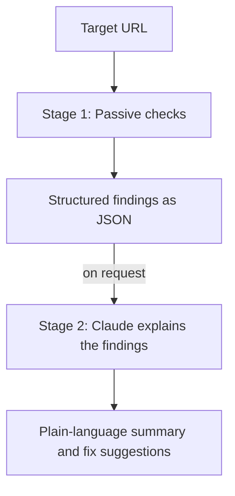
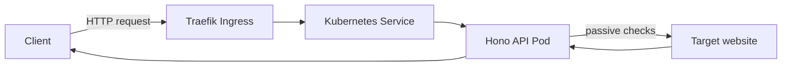
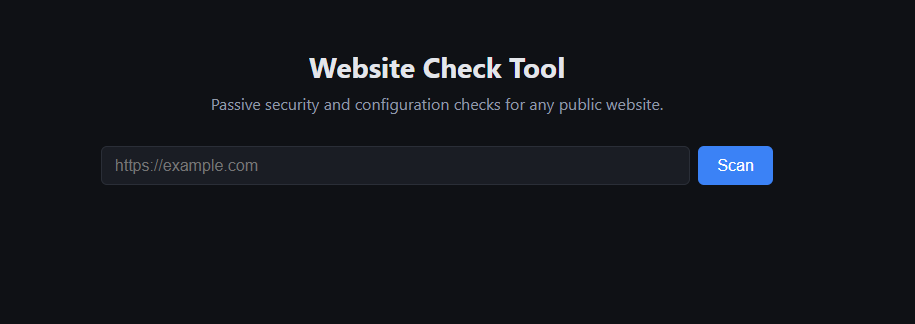
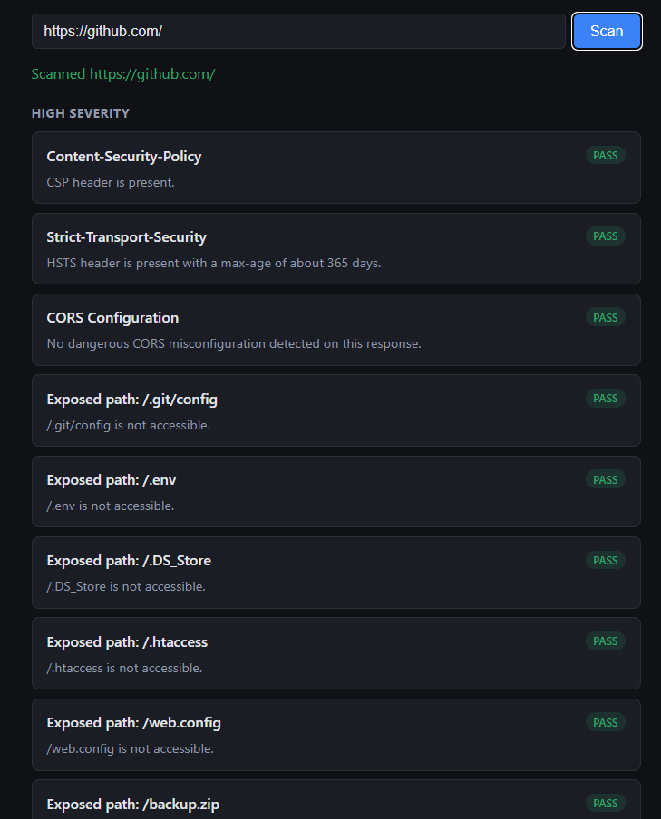
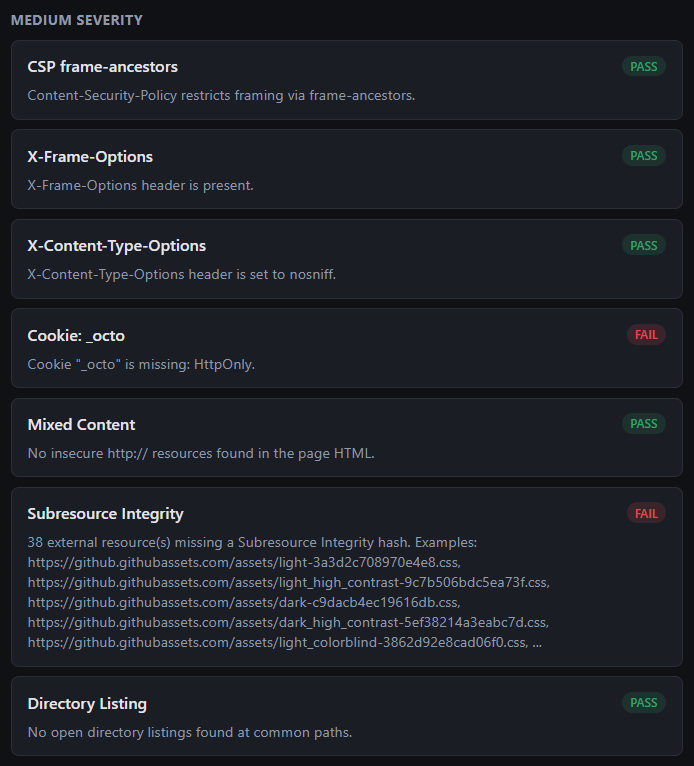
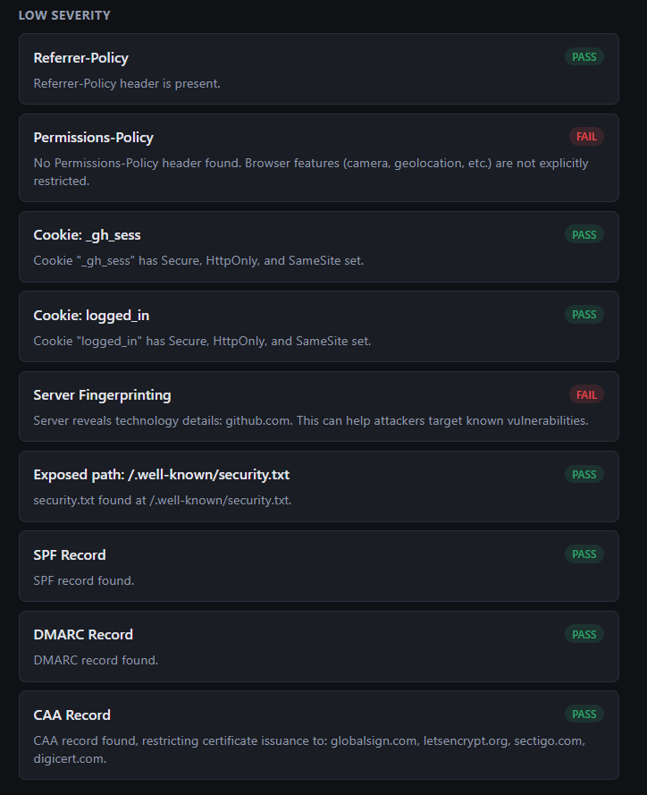
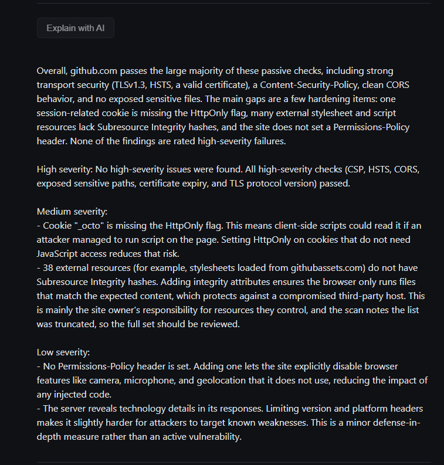

<div align="center">

# Website Check Tool

A website security and configuration checker built to learn Kubernetes end to end, from a Hono API to a production deployment with CI/CD.


</div>

## Table of Contents

- [About](#about)
- [Why Kubernetes](#why-kubernetes)
- [How It Works](#how-it-works)
- [Checks](#checks)
- [Technologies](#technologies)
- [Architecture](#architecture)
- [Getting Started](#getting-started)
- [Production Deployment](#production-deployment)
- [Security Considerations](#security-considerations)
- [Screenshots](#screenshots)
- [Roadmap](#roadmap)
- [License](#license)

## About

This tool scans a website for common security misconfigurations, missing protections, and accessibility issues, and reports them in plain language, with an optional AI-generated summary. It started as a learning project for Kubernetes and grew into something I actually wanted to exist: a quick way to check whether a site has basic security hygiene in place.

The tool is intentionally not hosted publicly. It makes outbound requests to whatever URL it is given, which is the kind of behavior that looks like scanning to automated defenses, so running it as an open, unrestricted public service would be irresponsible. See [Security Considerations](#security-considerations) for the reasoning. Anyone is welcome to clone this repository and run it themselves, locally or on their own infrastructure.

## Why Kubernetes

A project this size could run comfortably on Docker Compose. I chose Kubernetes anyway, deliberately, as the vehicle to learn Deployments, Services, Ingress, ConfigMaps, Secrets, CronJobs, RBAC, and the security primitives Kubernetes offers (Pod Security Standards, security contexts, resource limits, PodDisruptionBudgets) on a project that actually does something, rather than on throwaway exercises. The tradeoff is honest: more operational complexity than this app strictly needs, in exchange for real, transferable Kubernetes experience, including a CI/CD pipeline proven once against a real production cluster (see [Production Deployment](#production-deployment)).

## How It Works

The scanner works in two stages.



**Stage 1** runs a set of deterministic, read-only checks against the target: header analysis, TLS inspection, DNS lookups, and HTML parsing. No check sends attack payloads or attempts to exploit anything, it only observes what the site already exposes. A single failing check never aborts the scan, each check is isolated and reports its own outcome.

**Stage 2** is a separate, opt-in step. The server re-runs the checks itself rather than trusting findings supplied by the client, then sends them to Claude (Haiku) with a system prompt that explicitly treats the findings as data, never as instructions, to guard against prompt injection from a scanned page's own content. The API key is only ever used server-side.

## Checks

<details>
<summary><strong>HTTP response analysis</strong></summary>

- Security headers: CSP (including `frame-ancestors`), HSTS (including whether `max-age` is long enough to be meaningful), X-Frame-Options, X-Content-Type-Options, Referrer-Policy, Permissions-Policy
- Cookie flags: Secure, HttpOnly, SameSite
- Server fingerprinting via Server and X-Powered-By headers
- CORS misconfiguration (wildcard origin combined with credentials)

</details>

<details>
<summary><strong>Additional passive requests</strong></summary>

- Exposed paths: `.git/config`, `.env`, `.DS_Store`, `.htaccess`, `web.config`, `backup.zip`, `config.php.bak`, `security.txt`
- TLS certificate expiry and protocol version
- Mixed content (HTTP resources loaded on an HTTPS page)
- Subresource Integrity on external scripts and stylesheets
- Directory listing at common paths (`/images/`, `/uploads/`, etc.)

</details>

<details>
<summary><strong>DNS based</strong></summary>

- SPF record
- DMARC record
- CAA record

</details>

<details>
<summary><strong>Accessibility (local development only)</strong></summary>

WCAG checks via a headless Chromium browser and axe-core. This needs a real browser process, which is only installed in local development (`ENABLE_ACCESSIBILITY=true` in a local `.env`), never bundled into the production image, to keep the deployed container small and avoid the extra resource and security surface a browser brings to a shared production host.

</details>

All checks are passive. The tool never sends exploit payloads or attempts authentication bypass, it only reads what a target already makes public. Checks were deliberately limited to ones with a real, explainable security relevance, a few early candidates (`robots.txt`, `sitemap.xml`, a well-known change-password URL) were removed because they carry no actual security signal.

## Technologies

| Technology | Role |
|---|---|
|  | Language for the API and all checks |
|  | Runtime |
|  | Web framework for the API |
|  | Generates plain-language explanations of scan findings (Haiku) |
|  | Headless-browser accessibility checks (local development only) |
|  | Structured JSON logging |
|  | Builds and runs the API as a container |
|  | Orchestrates the deployment |
|  | Ingress controller for local development |
|  | Built and deployed the image to production (see below) |

## Architecture



The API runs as two Deployment replicas in their own namespace (enforcing Kubernetes' restricted Pod Security Standard), behind a ClusterIP Service. Locally, a Traefik Ingress routes external traffic in. Configuration lives in a ConfigMap, the Anthropic API key in a Secret. A weekly CronJob calls the Service over Kubernetes' internal DNS to re-scan a known site and catch configuration drift over time, such as an expiring certificate or a header that quietly changed, rather than looking for the same bug twice. A PodDisruptionBudget guarantees at least one replica stays available during planned node maintenance, complementing the rolling-update strategy, which only covers deployments initiated by this project itself.

## Getting Started

### Prerequisites

- Node.js 22 or newer
- Docker
- [k3d](https://k3d.io)
- kubectl

### Local development

```bash
cd api
npm install
cp .env.example .env   # add your own ANTHROPIC_API_KEY, optionally set ENABLE_ACCESSIBILITY=true
npm run dev
curl http://localhost:3000/health
```

### Docker

```bash
cd api
npm run build
docker build -t website-check-api:dev .
docker run --rm -p 3000:3000 website-check-api:dev
```

### Kubernetes

```bash
k3d cluster create website-check-tool --port 80:80@loadbalancer --port 443:443@loadbalancer
k3d image import website-check-api:dev -c website-check-tool

kubectl apply -f k8s/namespace.yaml
kubectl apply -f k8s/configmap.yaml
kubectl create secret generic website-check-ai \
  --namespace website-check-tool \
  --from-literal=ANTHROPIC_API_KEY=your-key-here

kubectl apply -f k8s/deployment.yaml
kubectl apply -f k8s/service.yaml
kubectl apply -f k8s/ingress.yaml
kubectl apply -f k8s/cronjob.yaml
kubectl apply -f k8s/pdb.yaml

kubectl rollout status deployment/api -n website-check-tool
```

Test through the Ingress:

```bash
curl -H "Host: websitecheck.local" "http://localhost/check?url=https://example.com"
```

Add `127.0.0.1 websitecheck.local` to your hosts file to drop the manual Host header and browse the UI directly.

## Production Deployment

A GitHub Actions pipeline was built and proven against a real k3s cluster on a self-hosted VPS: on push, it builds the image, pushes it to GitHub Container Registry, then connects over SSH to run `kubectl set image` and wait for a successful rollout.

The deployment account for this is intentionally minimal, separate from any other automation on that server:

- A dedicated SSH key, used for nothing else
- An SSH **forced command**: the key can only ever run one fixed deploy script, regardless of what is actually sent over the connection
- A Kubernetes **ServiceAccount** with a `Role` scoped to exactly what the script needs (`get`/`list`/`watch`/`patch` on Deployments in one namespace), nothing else, not even read access elsewhere in the cluster

The pipeline successfully built, pushed, and deployed the application to that production cluster. Afterward, the Kubernetes install on the VPS was deliberately removed again: that server already runs other always-on services, and a second orchestration layer sitting idle for a privately-used tool is unnecessary operational surface. The manifests in `k8s/production/` and the deployment logic remain in the repository; redeploying is a matter of reinstalling k3s and reintroducing the GitHub secrets.

## Security Considerations

- **SSRF protection:** every target URL is resolved and checked against private IP ranges and localhost before any request is made, so the scanner cannot be used to probe internal infrastructure.
- **Browser-based requests are filtered too:** the (local-only) accessibility check loads pages in a real browser, which makes its own sub-requests; those are checked against the same private-address rules so the browser can't be used to reach internal services via an embedded resource.
- **Rate limiting:** separate, lower limits apply to the AI explanation and accessibility endpoints, since both are meaningfully more expensive than a plain scan. The limiter trusts the `X-Forwarded-For` header set by Traefik, which is safe here because the Service is ClusterIP only, nothing outside the cluster can reach the Pod directly and forge that header.
- **AI explanation layer:** findings are re-computed server-side rather than trusted from the client, so the endpoint can't be used as an open relay to get arbitrary text explained by Claude. The system prompt explicitly frames the findings JSON as data, not instructions, as a defense against prompt injection from a scanned page's own content. Finding details are truncated before being sent, limiting both cost and injection surface.
- **Passive only:** no check sends exploit payloads or attempts authentication bypass. This is a deliberate scope decision, not a limitation to work around.
- **Timeouts and size limits:** every outbound request has a timeout with a hard backstop, and response bodies are capped, so a slow, unresponsive, or oversized target can't tie up the scanner.
- **Container hardening:** Pods run as a non-root user, with a read-only root filesystem, no Linux capabilities, and the namespace enforces Kubernetes' restricted Pod Security Standard.
- **Least-privilege CI/CD:** see [Production Deployment](#production-deployment).

Known limitations, documented rather than engineered around:

- The server fingerprint check flags any `Server` header as a potential leak, which produces occasional false positives for header values that are branding rather than version information.
- SSRF protection resolves a hostname once before fetching; a narrow DNS-rebinding window exists between that check and the actual request.
- The accessibility check's browser sandbox runs with `--no-sandbox`, the standard, documented approach for running headless Chromium in a container, relying on the Pod's own isolation instead of Chromium's internal one.

## Screenshots



**Scan results**





**AI explanation**



## Roadmap

- [x] Security header checks, including CSP `frame-ancestors` and HSTS `max-age` evaluation
- [x] Cookie, server fingerprint, and CORS checks
- [x] Exposed path and directory listing checks
- [x] TLS, mixed content, and Subresource Integrity checks
- [x] SPF, DMARC, and CAA checks
- [x] SSRF protection and rate limiting
- [x] Structured logging
- [x] Frontend
- [x] AI-powered explanations (Claude)
- [x] Accessibility checks (WCAG via axe-core, local development only)
- [x] Kubernetes deployment: Deployment, Service, Ingress, ConfigMap, Secret, CronJob, PodDisruptionBudget
- [x] CI/CD pipeline, proven against a real production cluster
- [ ] HorizontalPodAutoscaler (needs a metrics-server not present in this setup)
- [ ] Helm chart, if this ever needs to support more than one environment

## License

MIT, see [LICENSE](LICENSE).